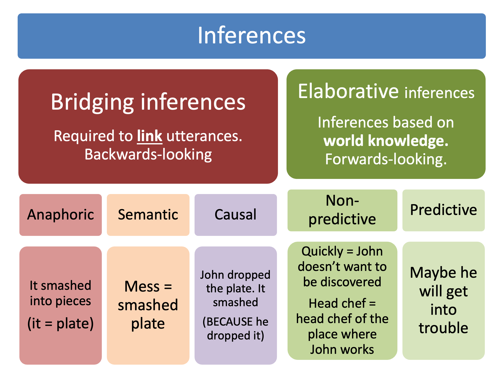
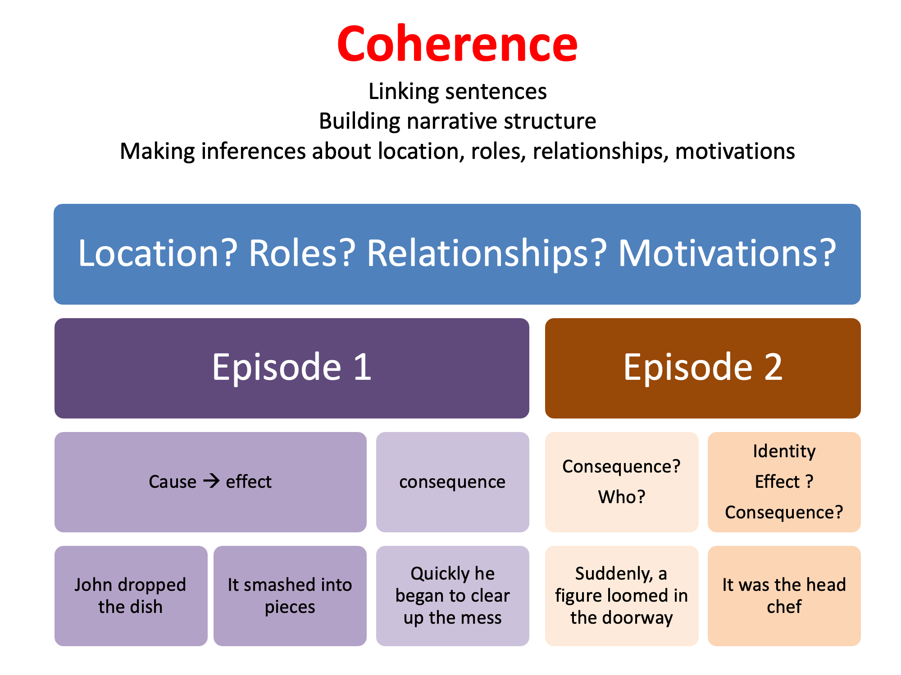
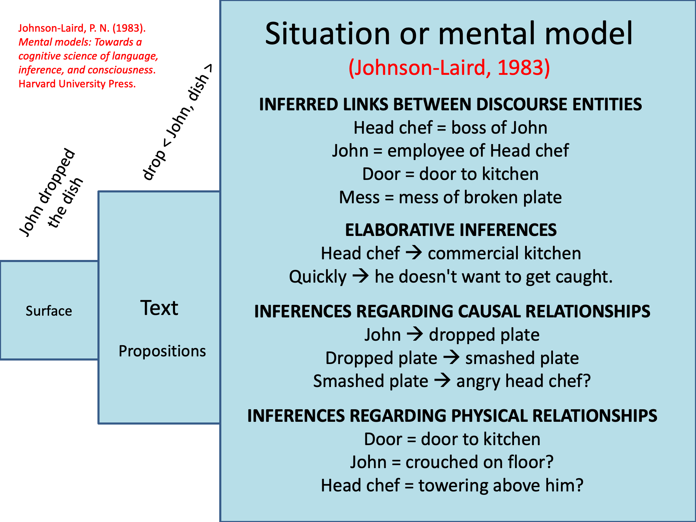

# 04 - Discourse and Exchanges (Conversation Analysis)

## Discourse

### What is discourse?

What is a discourse? A unit of language which is larger than a single sentence / utterance.

Can be monologic (produced by a single person) or dialogic (with multiple speakers)

During discourse processing we make *inferences* (informed guesses). We do this by processing language in context. The context can be...

(a) linguistic context, e.g. Previous utterances
    - This is Patrick. He’s my best friend.

(b) interactional context, e.g. What we know about the other speaker
    - We’ve run out of milk

(c) situational context; the environment around us
    - Would you mind keeping the noise down?

### Discourse exercise

What kind of inferences do you make when processing the following?

John dropped the dish.
It smashed into pieces.
Quickly he began to clear up the mess.
Suddenly, a figure loomed in the doorway.
It was the head chef.

Possible answers

1. dish = kitchen receptacle (not satellite dish)
2. It = dish
3. Quickly = what are his motivations? Is he trying to avoid being discovered?
4. Who is the figure? Why does the figure "loom"? Is this a large person? Is there a connection between the smashed plate and the looming figure. Has the looming figure heard the noise?
5. It = figure
6. So, is the looming figure the head chef of the kitchen where the protagonist works?

The following diagram shows the type of inferences we make

### Types of inferences

#### Bridging inferences

These inferences serve to link either sentences or clauses in some way. All of them involve looking back in some way, e.g. establishing links between the current sentence and previous sentences

"Anaphoric" = an inference which involves linking a placeholder expression to a previously stated referent

"Semantic" = an inference which involves resolving semantic relationships between discourse entities.

"Causal" = an inference about causal relationships between events

#### Elaborative inferences

These do not involve looking back and may involve looking forwards

"Non-predictive" = 

## Processing of inferences

### Main questions

How active are we in generating inferences?

Is there any cost to generating inferences?

### Techniques

1. Recognition tests (e.g. which of the following sentences did you hear? Carefully John began to clear up the mess / Quickly John began to clear up the mess)
2. Online tasks, e.g. naming, recognition and lexical decision
3. Eye-tracking
4. fMRI / EEG

### The situation / mental model

We build up a richly structured representation including information about (i) links between entities, (ii) Elaborative inferences, (iii) causal inferences, (iv) inferences regarding physical relationships.

Surface form > *more fragile than* > Propositional form ("text" form) > *more fragile than* > Situation or mental model

Cycles of activation of inferences followed by "pruning", e.g. "dish" triggers "kitchen receptacle" meaning, which further triggers "kitchen" which triggers a range of activities you might perform in the kitchen etc.

Pruning ensures that we don't keep too many possible inferential pathways open, which presumably overloads processing.